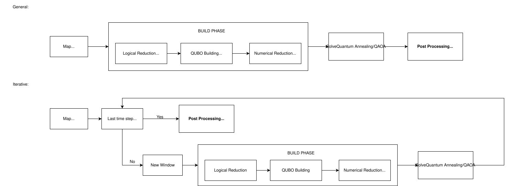

# Spooky - Quantum Multi-Robot Path Planning

[](https://arxiv.org/abs/2602.14799)

> **⚠️ Alpha**: Spooky is under active development (0.x). The method is published ([arXiv:2602.14799](https://arxiv.org/abs/2602.14799)); APIs, defaults and penalty sets may still change between releases.

A hybrid quantum-classical framework for multi-robot path planning using QUBO (Quadratic Unconstrained Binary Optimization) formulations. The QUBOs target quantum annealing and gate-based quantum algorithms (QAOA), and run today on simulated annealing, QAOA simulators and IBM / IQM hardware, in both grid and graph environments.

## ✨ Key Features

- **Quantum and classical backends**: QAOA via PennyLane (simulators, IBM Quantum and IQM hardware), simulated annealing (D-Wave Ocean's `neal`, local), and exact classical baselines (CBS, ILP)
- **Multi-robot coordination**: vertex, swap and clearance (robot footprint) collisions; finished robots stay parked on their goal (hold-goal)
- **Grid and graph environments**, with obstacles and terrain costs
- **Windowed solving**: sliding time windows sized to the variable / qubit budget, with an arrival-time goal term that keeps short windows heading the right way
- **Pre-processing**: BFS reachability pruning and a diagonal fixer that shrinks each window before it reaches the solver
- **Calibrated defaults**: SA read budget, QAOA angles and shot counts tuned on recorded windows (`quantum.benchmark.calibration`)
- **Benchmarking and sweeps**: validation, invalid-cause attribution and paired statistical comparisons
- **FastAPI server** for remote planning, plus visualization of paths and solving progress

## 🏗️ Architecture

```
quantum_nav/
├── quantum/                 # Core package
│   ├── builder/             # QUBO builders (grid, graph), window pre-processing,
│   │                        # ILP and CBS builders
│   ├── solvers/             # SA (neal), PennyLane QAOA, ILP, CBS; SolverFactory
│   ├── hardware/            # IBM Quantum and IQM backends / sessions
│   ├── benchmark/           # BenchmarkRunner, sweeps, calibration, analysis
│   ├── config/              # Penalty sets, materials, parsers
│   ├── maps/                # Synthetic maps (YAML source + HDF5) and problems
│   ├── demos/               # Numbered usage examples (01_quickstart ...)
│   ├── tests/               # pytest suite
│   ├── utils/               # Paths, validation, logging, pre-processing modes
│   ├── map.py               # Grid / Graph environments
│   ├── pathFormulation.py   # PathfindingProblem (robots + environment)
│   ├── qubo_cli.py          # CLI (spooky-solve)
│   └── qubo.py              # Annotated lab script
├── fastapi_app/             # FastAPI server and web demo
└── sweep_configs/           # Sweep definitions (spooky-sweep)
```

## 🔄 Solving Pipeline



**General (top):** the map enters a Build Phase (Logical Reduction → QUBO Building → Numerical Reduction), then goes to Solve and Post-processing.  
**Iterative (bottom):** at each window the solver checks whether the last timestep or goal is reached. If yes, post-processing runs. If no, a new window triggers another Build Phase → Solve cycle, and the result feeds back into the next iteration.

| Stage | What happens |
|---|---|
| **Logical Reduction** | BFS reachability per robot (`bfs_safe`: waiting allowed; `bfs_aggressive`: no revisits) fixes start/goal variables and computes the sparse `_active_cells` set, routing around cells parked robots hold — constraints are only built over reachable positions. |
| **Build QUBO** | Penalty terms (one-hot, adjacency, start, arrival-time goal term, lock-after-goal, collision / swap / clearance) are applied exclusively over `_active_cells`, keeping the matrix small. |
| **Numerical Reduction** | The diagonal fixer (`reduce_diag_fixed_vars_iterative()`, modes `full` / `full_safe`) greedily pins variables from their own diagonal coefficient, keeping each robot's pins a connected path and avoiding cells other robots are committed to; `fixer="contested"` also leaves steps where two robots' preferred paths meet to the solver. It is a heuristic: it shrinks windows (QAOA needs it to fit its qubits) but can commit a poor choice. |
| **Solve** | The reduced QUBO is submitted to the selected backend. Default pre-processing is `bfs_safe` for SA and `full` for QAOA. |
| **Post-process** | Fixed variables are merged back into the raw sample, the path is decoded, invalid moves are detected and corrected, and the window advances. |

## 🚀 Installation

### Basic Installation

```bash
# Clone the repository
git clone https://github.com/JavideuS/Spooky.git
cd Spooky

# Create virtual environment (recommended)
python -m venv venv
source venv/bin/activate  # On Windows: venv\Scripts\activate

# Install core dependencies
pip install -e .

# Generate map files from YAML definitions (optional - maps are pre-generated)
python quantum/maps/generate_all_maps.py
```

### Optional Dependencies

```bash
# For PennyLane GPU acceleration (requires NVIDIA CUDA, not available on Windows)
pip install -e ".[gpu]"

# For D-Wave quantum annealing
pip install -e ".[dwave]"

# For IBM Quantum hardware access
pip install -e ".[ibm]"

# For IQM Quantum hardware access (via Resonance)
pip install -e ".[iqm]"

# For Jupyter notebook support
pip install -e ".[jupyter]"

# Install all optional dependencies
pip install -e ".[gpu,dwave,ibm,iqm,jupyter]"

# To install all
pip install -e ".[all]"

# On Windows: same as [all], but without the gpu extra (PennyLane ships no
# lightning-gpu/CUDA wheels for Windows). Use --device lightning.qubit instead.
pip install -e ".[windows]"
```

## 📖 Quick Start

More complete examples are in [`quantum/demos/`](quantum/demos/) (`01_quickstart.py` → `06_advanced_features.py`).

### Command-Line Interface

After installation, the `spooky-solve` command is available from anywhere:

```bash
# Simulated annealing (local, neal)
spooky-solve --map quantum/maps/synthetic/10x10/obs10x10_hard --problem four_robots

# PennyLane (GPU)
spooky-solve --map quantum/maps/synthetic/5x5/obs5x5_hard --problem hard --solver pennylane --device lightning.gpu --benchmark --num-runs 5

# PennyLane (windows/gpuless)
spooky-solve --map quantum/maps/synthetic/5x5/obs5x5_hard --problem hard --solver pennylane --device lightning.qubit --benchmark --num-runs 5

# Qiskit (IBM Quantum hardware)
spooky-solve --map quantum/maps/synthetic/10x10/no_obs10x10 --problem two_robots --solver qiskit_remote --verbose 3

# IQM Quantum hardware (via Resonance; auto-picks Garnet or Emerald based on qubit count)
spooky-solve --map quantum/maps/synthetic/10x10/no_obs10x10 --problem two_robots --solver qiskit_iqm --verbose 3

# IQM Quantum hardware, pinned to a specific machine
spooky-solve --map quantum/maps/synthetic/10x10/no_obs10x10 --problem two_robots --solver qiskit_iqm --machine garnet --verbose 3
```

### Python Library

Run from the repo root (paths are relative to it):

```python
import yaml
from quantum.pathFormulation import PathfindingProblem
from quantum.builder import QUBOBuilder
from quantum.solvers import SolverFactory
from quantum.benchmark.benchmark import is_solution_valid

penalties = yaml.safe_load(open("quantum/config/config.yaml"))["penalty_sets"]["crash"]

# Map + named problem (robots, starts, goals) from the YAML pair
problem = PathfindingProblem.from_map_config(
    "quantum/maps/synthetic/10x10/obs10x10_medium", "two_robots"
).as_grid_only()

builder = QUBOBuilder(problem, penalties=penalties)
# Simulated annealing; reads scale with each window. seed makes the run reproducible.
solver = SolverFactory.create_solver("dwave", seed=42)
solution = solver.solve(builder)  # windowed, with the solver's default pre-processing

path = solver.decode_path(solution["solution"], problem)
print(is_solution_valid(path, problem)["message"])
for robot_id, robot in problem.robots.items():
    print(robot_id, [cell[:2] for cell in robot.path])
```

QAOA uses the same builders; with no `params` it runs the tuned 2-layer
angles and the calibrated shot table. Solving updates the problem's robots
(paths, finished flags), so load a fresh problem per solve:

```python
problem = PathfindingProblem.from_map_config(
    "quantum/maps/synthetic/5x5/obs5x5_hard", "hard"
).as_grid_only()
solver = SolverFactory.create_solver("pennylane", device="lightning.qubit")  # or lightning.gpu
solution = solver.solve(QUBOBuilder(problem, penalties=penalties))
```

## 🔧 Configuration

The system uses YAML configuration files for problem definitions and penalty weights:

- `quantum/config/config.yaml` - Penalty sets (`crash` is the recommended default)
- `quantum/config/materials.yaml` - Terrain material costs
- `quantum/maps/synthetic/<size>/*.yaml` - Maps and their named problems
- `fastapi_app/config/solvers.yaml` - Named solver profiles for the API

See [`quantum/config/README.md`](quantum/config/README.md) for detailed configuration options.

## 📊 Benchmarking

Run benchmarks to evaluate solver performance:

```python
from quantum.benchmark.benchmark import BenchmarkRunner

benchmark = BenchmarkRunner(builder, solver, num_runs=10, level=1, seed=42)
results = benchmark.run_build()  # validates every run; JSON lands in results/benchmarks/
```

For the full `instance × solver × ablation` **sweep** matrix, run from the repo root:

```bash
spooky-sweep --config sweep_configs/classical_test.yaml
python -m quantum.benchmark.analysis.run_report -d results/sweeps/<sweep_id>
```

See [`quantum/benchmark/README.md`](quantum/benchmark/README.md) for benchmarking
options, the sweep workflow, the paired Wilcoxon methodology, and how to read
the aggregated tables; [`quantum/benchmark/analysis/README.md`](quantum/benchmark/analysis/README.md)
is the per-column reference for the CSV output.

## 🧪 Current Status

### Working

- ✅ Grid and graph QUBO formulations with the arrival-time goal term
- ✅ Multi-robot planning: vertex, swap and clearance collisions, hold-goal semantics
- ✅ Windowed solving with BFS pre-processing and the diagonal fixer
- ✅ Simulated annealing, PennyLane QAOA (CPU / GPU simulators, IBM Quantum, IQM), CBS and ILP baselines
- ✅ Calibrated SA read budget, QAOA angles and shot counts
- ✅ Benchmarking, sweeps and statistical analysis
- ✅ FastAPI server with named solver profiles and a web demo

### Known Limitations

- **Yielding**: a robot can't wait cheaply (a stay off the goal pays the adjacency penalty, and no single wait price works), so head-on traffic in one-lane corridors can livelock in `bfs_safe` (e.g. `obs10x10_hard` / `four_robots`; `full_safe` solves it).
- **Diagonal fixer**: a greedy heuristic; it can commit a robot to a poor route (see `fixer="contested"`).
- **D-Wave QPU**: the `dwave` backend always samples locally with `neal`; a real annealer is not wired up.

## 🔌 Integration

Spooky is designed as a standalone planner. It can be used in two ways:

**As a Python library:**
```python
from quantum.pathFormulation import PathfindingProblem
from quantum.builder import QUBOBuilder
from quantum.solvers import SolverFactory
```

**Via FastAPI** (`cd fastapi_app && uvicorn api:app`):
```
POST /v1/plan  →  { map_id, solver, robots, penalty_set }  →  { paths, cost }
```
Solver profiles (`dwave.general`, `pennylane.inference.qaoa_GPU_general`, `classic.cbs`, ...) live in `fastapi_app/config/solvers.yaml`; see [`fastapi_app/README.md`](fastapi_app/README.md) for the other endpoints.

Robot framework integration (ROS2, DiMOS) is handled by [argOS](https://github.com/JavideuS/argOS), which uses Spooky as a planning backend.

## 🤝 Contributing

This project is currently in active research and development. Contributions, bug reports, and suggestions are welcome! Please note that the codebase is evolving rapidly.

## 📄 License

This project is licensed under the Apache License 2.0 - see the [LICENSE](LICENSE) file for details.

The academic paper is licensed under the [Creative Commons Attribution 4.0 International License (CC BY 4.0)](http://creativecommons.org/licenses/by/4.0/).

## 📧 Contact

**JavideuS** - javi.rm2005@gmail.com

## 🙏 Acknowledgments

This project uses:

- [PennyLane](https://pennylane.ai/) for quantum circuit simulation and optimization
- [D-Wave Ocean SDK](https://ocean.dwavesys.com/) (`neal`) for simulated annealing
- [Qiskit](https://qiskit.org/) for IBM Quantum hardware access
- [Qrisp](https://qrisp.eu/) and [IQM's iqm-client](https://docs.iqm.tech/) for IQM Quantum hardware access via Resonance

## 📖 Citation

If you use this software in your research, please cite the paper:

**Scalable Multi-Robot Path Planning via Quadratic Unconstrained Binary Optimization**  
_Javier González Villasmil, et al._  
arXiv preprint arXiv:2602.14799, 2026.

```bibtex
@misc{gonzalezvillasmil2026scalablemultirobotpathplanning,
      title={Scalable Multi-Robot Path Planning via Quadratic Unconstrained Binary Optimization},
      author={Javier González Villasmil et al.},
      year={2026},
      eprint={2602.14799},
      archivePrefix={arXiv},
      primaryClass={cs.RO},
      url={https://arxiv.org/abs/2602.14799},
}
```

---

**Note**: This is an active research project. For the most up-to-date information, please check the repository regularly or contact the author.
